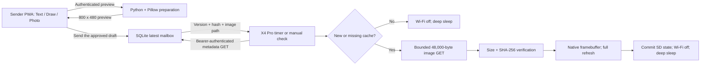

# Integrated ambient display architecture

This describes the Messages feature and the mailbox protocol that Method, Register and Messages share. The
mailbox itself is the Python demo in `sender-web/` or the Plaque Worker that comes with the Plaque Mac app
(github.com/samporter14/plaque). CrossPoint remains the running application. Messages is a native activity, with a selectable cached
message sleep screen and an opt-in timer wake path. The reader, library and existing sleep screens
continue through their upstream activities. There is one firmware image and one build target.



## Hooks verified in upstream before changes

At the baseline commit, `platformio.ini:330` selects the X4 Pro environment. `lib/hal/HalDisplay.h:79`
exposes the existing framebuffer; `src/activities/boot_sleep/SleepActivity.cpp:503` chooses sleep
presentation; `src/main.cpp:337` handles reader state and deep sleep; and `src/main.cpp:488` mounts
storage before settings and display initialization. The SDK's
`freeink-sdk/libs/hardware/PowerManager/src/PowerManager.cpp:147` arms button
wake without clearing timer wake. `src/activities/settings/SettingsActivity.cpp:99` provides the
system menu extension point, and `UiListActivity` provides touch/button list navigation.

The baseline downloader's `src/network/HttpDownloader.cpp:36` calls `setInsecure()`. The new `fetchBounded()`
method lives in the same CrossPoint HTTP abstraction and uses the already supplied ESP-IDF HTTP
client plus its CA bundle for certificate chain and hostname verification. Existing reader
requests keep their existing call paths. Redirects are rejected, including redirects to other origins.

The X4 Pro builds with `partitions-x4pro.csv` (two application slots of `0x7E0000` bytes, as read from a
reader) and the X4 Classic with `partitions-x4c.csv`. The SDK submodule revision and the SD-card firmware
update code are unchanged by this feature. The network update check against upstream releases is removed,
because an upstream image would replace the custom features; maintaining this fork means rebasing and
rebuilding it, and installing the image from the card or over USB.

## Device components

| Component | Role |
|---|---|
| `src/ambient/AmbientProvider.h` | Provider contract: fetch, status, content availability, render |
| `MessageProtocol.*` | Host-testable metadata, origin, version and bitmap-size rules |
| `AmbientSettings.*` | Existing PersistableStore mechanism, separate SD configuration and state |
| `LatestMessageProvider.*` | Bounded fetch, validation, two SD cache slots, framebuffer presentation |
| `activities/ambient/*` | Native Messages menu and full-screen viewer/check activity |
| `SleepActivity` hook | Prefer valid cached message when selected; otherwise use the upstream sleep behavior |
| `main.cpp` timer branch | Check before display initialization; return directly to deep sleep |
| `HalPowerManager` optional timer | Add a timer source while preserving the SDK power-button wake path |

Configuration lives at `/.crosspoint/ambient-config.json`; version/hash and active SD cache slot live
at `/.crosspoint/ambient-state.json`. Cache files are `/.crosspoint/ambient/frame0.bin` and `frame1.bin`.
The inactive file receives a download. Its exact length and SHA-256 must pass before it is displayed.
The displayed version is committed only after the panel refresh. A failed state save restores the
previous in-memory version so a later check can retry. These are SD files, separate from OTA slots.

The provider serializes its content state across the main and render tasks. Network buffers are scoped:
2 KB for bounded JSON, a reusable 1 KB transfer/hash block, and ArduinoJson/TLS client allocations.
They avoid large task-stack arrays and a second 48 KB framebuffer. Image bytes go directly from the
validated SD file into the existing HAL framebuffer. No JPEG/HEIC decoding or dithering runs on the device.
The payload uses native landscape panel coordinates; returning to reader activities retains their own
orientation settings. The supported wire format is checked against actual HAL dimensions at runtime.

## Menu and power behavior

Open **Settings → System → Messages** on X4 Pro. The menu includes View latest, Check now, mailbox
base URL, device ID, masked token entry, polling interval, latest-message sleep screen, sleeping checks,
and an explicit local HTTP development switch. This initial menu location keeps all home themes intact.
Use the normal Wi-Fi picker during the first manual check and save the network.

Polling defaults to 60 minutes (configurable 5–1440). The latest-message sleep option and sleeping
checks both start off. A valid configuration plus both options enables the timer. The timer is armed
when entering sleep. Pressing the power button follows normal reader resume routing. A scheduled wake
loads saved Wi-Fi credentials, tries the last network for at most 10 seconds, and performs two bounded
requests only when needed. Each HTTP request has a 5-second socket timeout and a 20-second transfer
budget checked between reads. Panel initialization and refresh occur only for validated new content.
Unchanged versions, empty mailboxes, authentication errors and network failures leave the panel untouched.
All outcomes turn Wi-Fi off before sleep. Scheduled wakes keep the frontlight off.

At a reported battery level below 15%, a timer wake stops scheduling subsequent polls until a later
manual sleep re-arms them. Battery-gauge accuracy, wake latency, real current draw, display polarity,
resume behavior and rail handling require the physical device. No battery-life duration is claimed.
A manual check uses normal UI progress/error screens and can repaint a cached message; the unchanged
timer path is the path that skips all panel updates.

### A Method step outranks the ambient screen

Sleeping inside a Method book (a book under `/Lamina/Method/`) is always a Quick Resume sleep: the reader's
current screen stays on the panel with the moon mark, whatever Settings > Sleep Screen says and even with
the ambient screen on. That screen is the step, or the Steps list if that is what was open. `enterDeepSleep()`
decides this with `sleepframe::planSleep` (`src/ambient/SleepFrame.*`) before anything can draw, so the
sleep-time plugin "Loading" popup and handler toasts are skipped for that sleep (delivery itself still runs),
and persists the result as `methodStepOnPanel` in `/.crosspoint/state.json`.

While the marker is set nothing paints over the panel:

- A timer wake reads the marker before it touches the display. The new note is still fetched and committed
  (`commitPending()`), but not drawn, and the re-sleep leaves the marker, the saved frame and the remembered
  book exactly as they were.
- If the SD card fails to mount on a timer wake, the device goes straight back to sleep (no wake timer, since
  the settings are unreadable) instead of drawing "SD card error"; a button wake shows the error.
- A ghost wake (a brief power bounce) re-arms the ambient timer the same way the timer re-sleep does (battery
  at least 15 %), so scheduled polling does not silently stop.

A power-button wake clears the marker and reopens the book at its saved page. Books outside `/Lamina/Method/`
keep the behaviour described above. A reader clears the remembered book when it opens one (a crash guard) and
remembers it again after its first page has painted, about a second later. A sleep in that window is still a
Method sleep: when the remembered path is empty, `enterDeepSleep()` uses the open reader's own path
(`ActivityManager::readerBookPath()`) and remembers it, so the wake reopens the book. The panel keeps whatever
it was showing at that moment (the shelf, or a page still being drawn). The crash guard is unchanged: the wake
clears the path and counts the open before it starts the reader, so a book that crashes on resume lands on
Home next boot. `test/sleep_frame` covers the whole sequence.

### A step timer outranks the weather too

A Method step page can carry a timer (tap its box, or Confirm › Start). A running timer is one more reason to be awake, kept in NVS
(not on the card: an ambient poll re-sleeps after the card has been shut down, and the record must be rewritten there) and handled
before the ambient poll in every path:

- **Sleeping with a timer running** is still a Method sleep (the step stays on the panel, marker set). The reader first draws the
  timer's end as a time of day into the frame ("Ends at 14:32" in place of a countdown that would freeze on the panel), then the moon.
  The wake timer is the sooner of the ambient poll and the timer's end less two seconds (`rearmMicros` asks a hook, so a poll that
  finishes while a timer runs, and a power bounce, wake for the end too).
- **An ambient poll in between** fetches and saves as above, draws nothing, rewrites the timer's wall-clock end (its clock sync may
  have stepped the clock) and re-sleeps for the next poll or the end, whichever is first.
- **The wake at the end** is checked before the poll: the poll is skipped, the boot is a splashless wake, and the retained frame is
  loaded. The alert (`StepTimerAlertActivity`) draws the inverted "0:00" over the timer's box on that frame, pulses the frontlight,
  and holds the reader awake until a press or touch, for at most 10 minutes. The first paint after a deep sleep is a half refresh of
  the whole panel (the controller discards its memory in sleep and the driver makes the first paint after a boot absolute), so the
  wake alert is one clean flash with the box inverted; an alert while the reader is awake refreshes only the box. A press goes on
  into the book as any wake does. After 10 minutes with no answer the light goes off, the panel keeps the finished timer, and a
  reader that woke by itself goes back to sleep (the marker is set again, so a poll will not draw over it).
- A timer found over by a person (a button wake after the end, or power lost while it ran) is shown without the light.
- The timer is counted on the hardware counter while the reader is awake and on the wall clock only across a sleep, and rewritten on
  the wall clock before every sleep and restart, so a clock sync never moves it. See `ambient/StepTimer.h`.

### The Register screen: an instrument's schedule

A reader stuck to an instrument can show that instrument's bookings as its sleep screen (docs/SPEC-REGISTER.md in the
Plaque repository). It is chosen per reader, in Settings > System > Messages > Register as sleep screen, and is exclusive
with the latest-message screen: the mailbox has no notes, weather or agenda for a registered reader, and a Register reader
does not poll `/latest`. It asks `GET /api/device/<id>/register` instead, with the same device token, identity headers,
verified TLS and clock sync as a note poll (`fetchBounded`, at most 8 KB), and a Method book check shares the wake as before.

- **Boards.** Register is offered by capability (`plaque::offersRegister`: the sleep screen, timed wake and the mailbox), so
  on every board that has Notes: the X4 Pro and the X4 Classic. Nothing about it has run on a Classic. See
  `x4c-support.md`, "Register: how it is gated, joined and budgeted".
- **Card.** The reply is read by one strict parser (`RegisterData`): bounded size, types, counts, times, and titles of 1 to
  40 characters of well-formed UTF-8 with no control or invisible characters. A reply that fails is thrown away whole. Two
  things are taken as they come: a booking's optional `"all_day": true` (a booking the calendar marks all-day is drawn as
  "All day", never as a 24-hour span; any value that is not a boolean is refused), and the `note`, whatever sentences the
  Worker puts in it: cut to 200 characters, dropped if it is not printable text, and shown on up to two lines. The
  schedule is kept as `/Lamina/register.json` (written to a temporary file and renamed) and read back through the same
  parser; a file that fails is ignored and left alone.
- **The screen** (`RegisterModel`, `RegisterLayout`) is drawn natively in portrait with the built-in fonts. The model works
  out what is true at the time it is asked for in the reader's own time zone and 12/24-hour setting, so it stays right
  between polls and over midnight. It says "Not known" rather than guess when the reply has never been read, the clock is
  not set (or reads before the reply), or not vouched for (after a flash or a power loss the system clock is only the floor
  restored from NVS, so Register takes it only when a sync set it this boot or the retained clock is trusted: `registerNow()`),
  or the day is past what the reply covered (the end of the day after it was made);
  Tomorrow is hidden, not shown empty, when the reply does not reach it. A note from the Worker (some repeating bookings
  could not be read, only part of a busy day is shown) means a bare "Free" cannot be promised: with nothing in progress the
  state reads "Free?" and the note is printed under it, in bold, in the state block (not down by the footer). In use stays
  "In use", and its note stays above the footer. A reply the Worker calls stale, or one older than
  max(30 minutes, twice the poll interval and 5 minutes), keeps the screen as it was and changes only the footer to
  "Calendar unavailable since ...".
- **Wakes** (`RegisterWake`). Both reasons to wake arrive as the ambient timer wake. The wake that is armed is the soonest of
  the poll (an interval after the last one, kept in RTC memory), the next boundary (a booking starts or ends, local
  midnight, the reading going stale; a few seconds early so the panel lands on it) and a running step timer's end, which
  the `sleepframe` wake hook adds, with the usual 15 % battery rule. A wake is a poll wake when the poll is due (within 15 s plus 2 % of the interval, since the timer counts on the
  internal clock) and a boundary wake otherwise; a boundary wake does no network (it needs only that Register is the sleep screen; the poll
  also needs "Check while sleeping" on and the mailbox set up). The "poll skipped near a timer's end" rule is unchanged,
  so a boundary inside the last 150 s of a step timer waits for the timer (160 s or 175 s on a reader with a network profile
  installed, whose wake join may take longer: `steptimer::pollBudgetMs`; the Register poll is one request where a note poll
  is two, so the same budget covers it). The poll joins as every scheduled wake does (`ambient::connectSavedWifi()`: the
  installed network profile and the last-used saved network, each with a budget of its own, whichever joined last first),
  and "Check the register now" joins the profile first and then the saved networks, as Messages does.
- **Redraw only on change.** What the last draw left on the panel (a hash of everything the screen says, and the time of
  its "As of" footer) is kept in RTC memory and cleared by every sleep that does not draw Register. A wake redraws when the
  hash differs, when the panel shows something else, or when a still-true footer is an hour behind the new reading
  (`FOOTER_REFRESH_S`; each draw is a full-panel refresh, so a footer that only moves forward does not flash the panel
  every poll). A Method step on the panel (the marker) outranks all of this: nothing is drawn, the schedule is still
  fetched and saved, and boundary wakes are not armed.
- **Battery.** Under 15 % the ambient wake stops, as for the weather; the last draw says "Battery low. This screen has
  stopped updating."
- **Awake.** Messages > View the register (or Check the register now) shows the same screen. The X4 Pro's side buttons
  are Left and Right (there is no Confirm key), and a tap is the same as Right. They go round one ring (`RegisterNav.h`):
  the screen, page 1, page 2 ... the last page, the screen. Right and a tap go forward round it, Left goes back, so every
  place has a way out with the side buttons alone; the full day's footer says which button does what. Back (a swipe from
  the left edge) returns to the screen, and from the screen leaves; the Home pad goes Home as everywhere. A check that
  fails still shows the saved schedule, with the failure in the footer.
- **Time zone.** The Worker's reply carries the instrument's own zone (`"zone": {"name", "spans": [{"from", "offset"}]}`),
  and every time on the screen (the day, today and tomorrow, day words, midnight, "covered until", 12/24-hour clock) is
  worked out from it, whatever zone the reader's own clock is set to. A reply without a valid zone (an older Worker) falls
  back to the reader's zone. A booking with `"clamped": true` has no end to state: it reads "until further notice".
- **A card that will not answer.** Register keeps a flag in RTC memory while it has a wake armed. A timer wake that finds
  the card will not mount (it is retried as for a step timer) or the mailbox settings will not load, with the flag set,
  sleeps five minutes and tries again, up to twelve times in a row, instead of ending the chain. A boundary that falls
  between the screen being decided and the wake being armed is not lost: the wake is armed for the boundary after the
  earlier of the two moments, which is already past, and so is the shortest wake, which redraws.

## Wire protocol v1

`GET /api/device/<device_id>/latest`, with `Authorization: Bearer <device_token>`:

```json
{
  "message_id": "m1",
  "created_at": "2026-10-03T14:00:00+00:00",
  "image_url": "/api/device/my-reader/image/m1",
  "sha256": "<64 lowercase hexadecimal characters>",
  "format": "mono1-msb-white",
  "width": 800,
  "height": 480,
  "byte_length": 48000
}
```

An empty mailbox returns `{"message_id":null}`. Metadata is limited to 2048 bytes. IDs contain only
ASCII letters, digits, hyphens or underscores. Image URLs must be the exact relative path for this
device and version, so the device token cannot be forwarded to arbitrary image hosts. The image GET
uses the same bearer token. The body contains top-to-bottom rows, 100 bytes per row, MSB first,
one meaning white and zero meaning black. It has no header or compression. The SHA covers all 48,000 bytes.

Unchanged means the version and hash match a valid local cache. A missing/corrupt cache causes a
repair download. The server also sends an ETag, but v1 always requests JSON and compares versions;
conditional `304` requests are a future optimization. A concrete golden fixture is in
`test/ambient_frame/fixtures/latest.json`, with matching `.bin` and `.png` files.

## Sender and server

The Safari-friendly PWA supplies text, an 800×480 pointer drawing canvas and a photo selector.
Photos are normalized to a portable PNG in the browser where possible, then the server applies camera
orientation, fit/center crop, grayscale and Floyd–Steinberg dithering. HEIC decoding depends on browser
support; a JPEG or PNG is the fallback. Color metadata/EXIF is discarded. Text uses bundled Noto Sans;
color emoji and full international typography are outside this prototype.

Preview preparation creates a private, expiring draft. Send atomically publishes the exact draft's raw
bitmap, SHA and an increasing SQLite version. The last two immutable server images are retained to cover
a metadata/download race. A very stale version returns `410`; the device keeps its image and retries
the latest metadata on a later check. There is one paired device and one sender secret in v1.
Duplicate sends of the same draft are rejected. There are no read receipts or push connections.

Sender authentication uses a separate secret and signed HttpOnly, SameSite=Strict cookies, with CSRF
and Origin checks on mutations. Device authentication is read-only bearer authentication. The PWA caches
only its static shell; API responses and private previews use `Cache-Control: no-store`. SQLite and `.env`
have private file permissions. Tokens on the SD card and the server content are plaintext at rest, so
private backups and control of the host/card are required. They are excluded from Git.

Local development uses a loopback-only service and explicitly enabled HTTP. Device development HTTP
is restricted to private IPv4 addresses, localhost or `.local` names. Deployed configurations require
an HTTPS public origin, secure cookies, a valid certificate trusted by the IDF CA bundle, and a reverse
proxy that terminates TLS while the Python service stays private. The device's clock must be set correctly
for certificate validity; use CrossPoint's clock sync during hardware setup. IPv6 origins and private
certificate authorities are not supported by this v1 settings UI.

## Extension points

Future calendar/dashboard providers can implement `AmbientProvider`. Add a provider selector only when
a second custom provider exists. Quiet hours can filter `wakeTimerMicros()` before arming the timer.
Message history, multiple pairs, direct reader-to-reader sending and native Share Sheet clients remain
future work. See [PROJECT-STATUS.md](PROJECT-STATUS.md).
