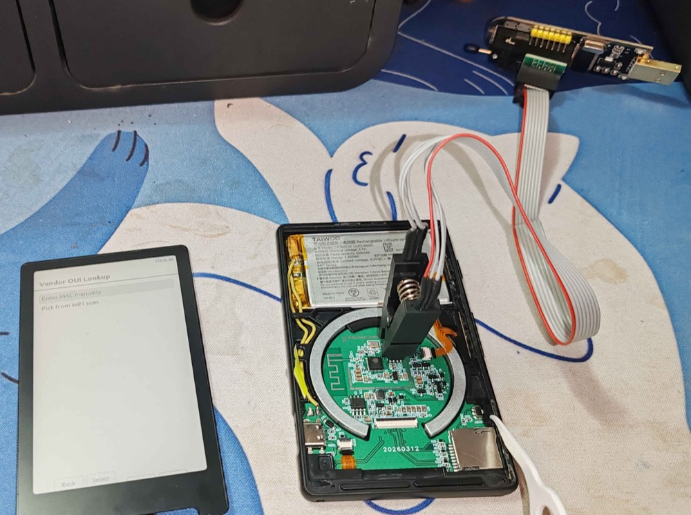
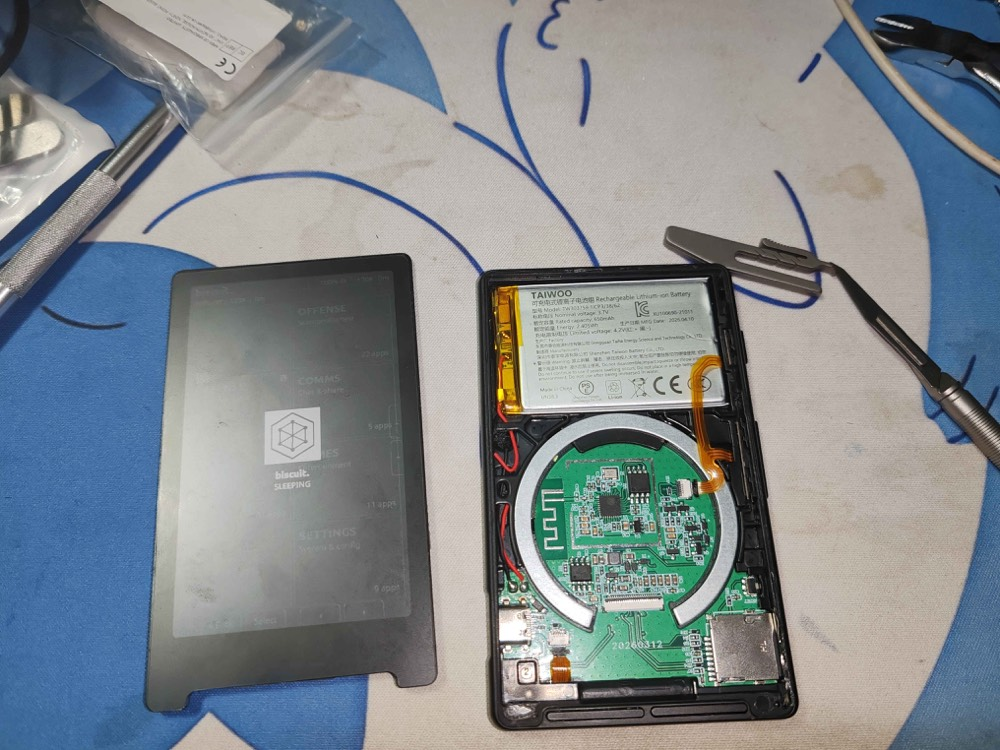
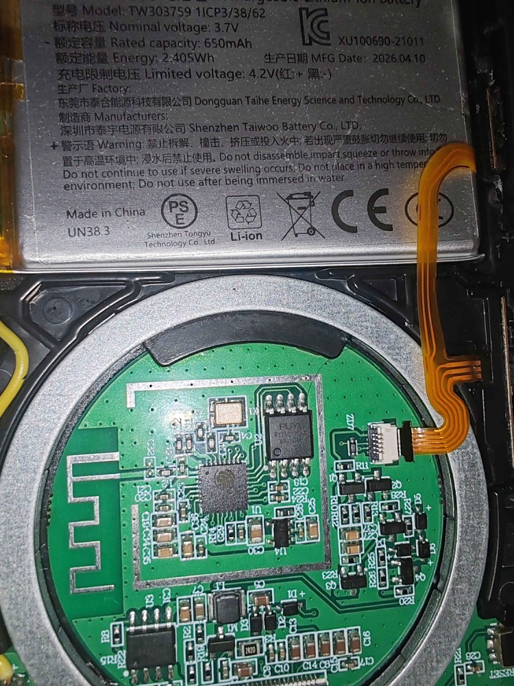
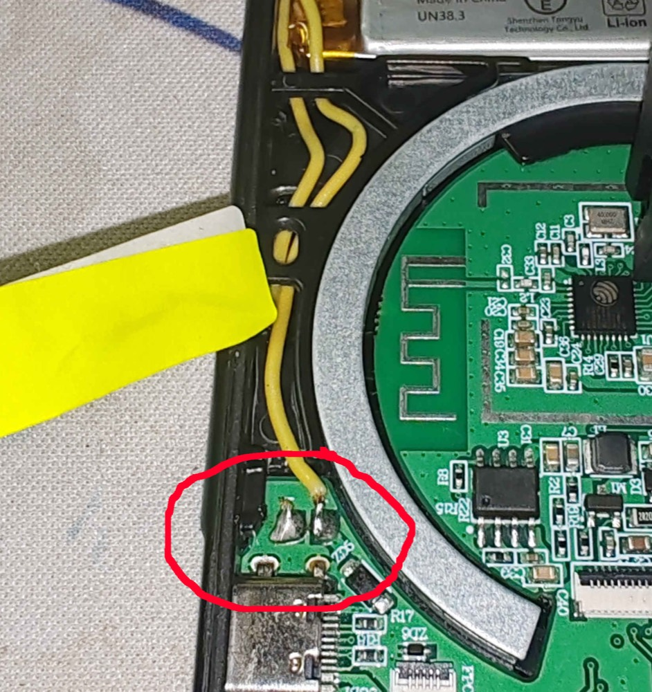
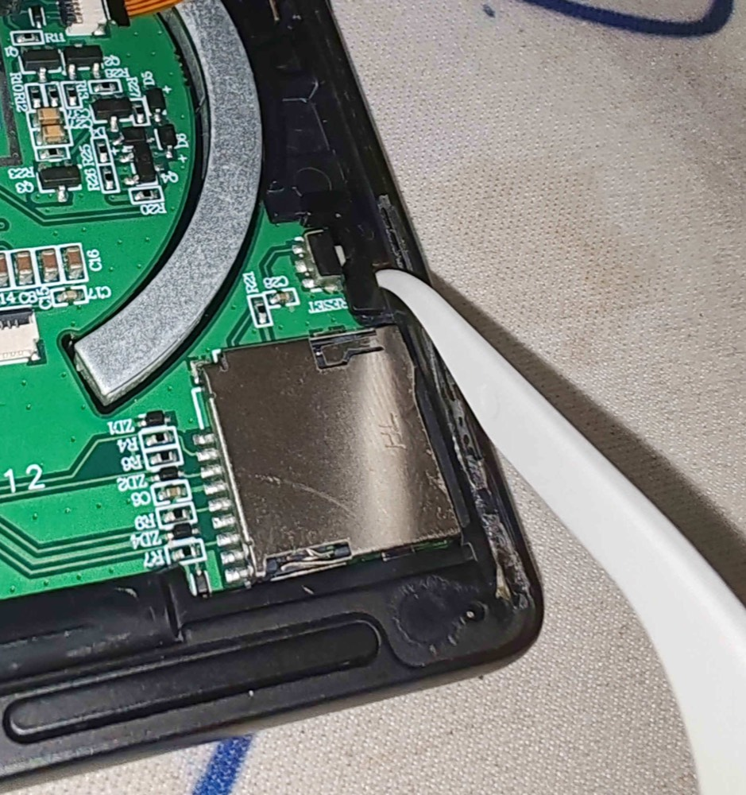
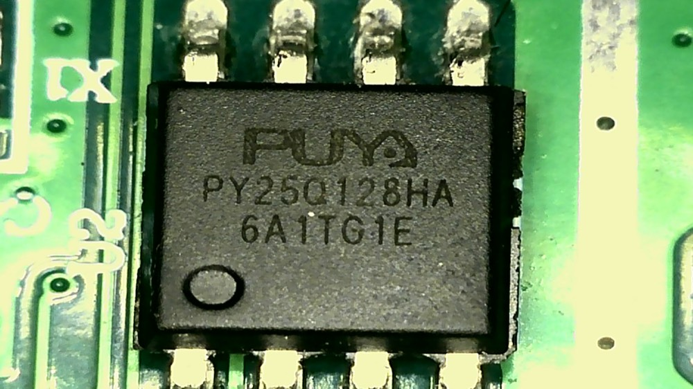
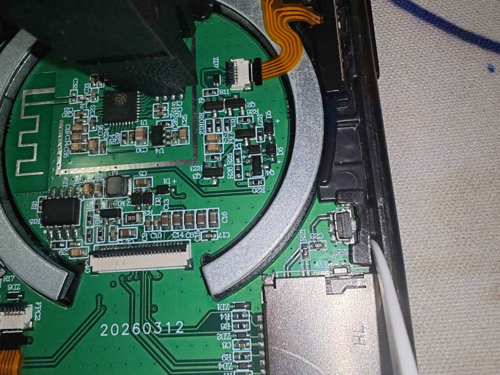
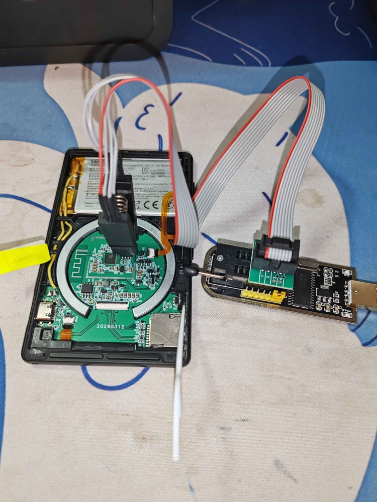
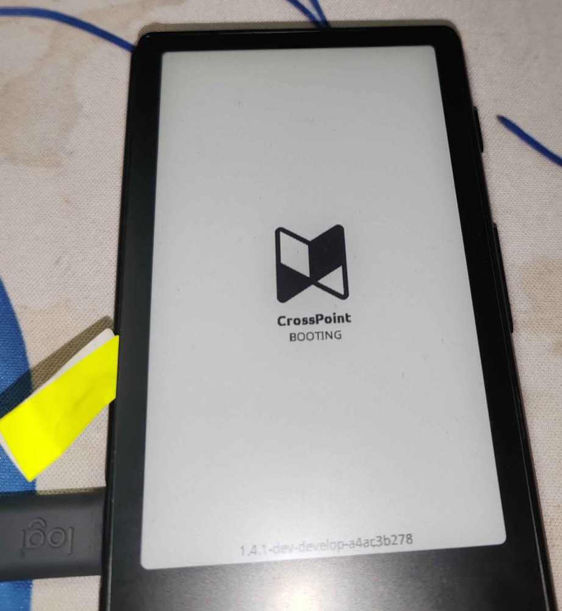
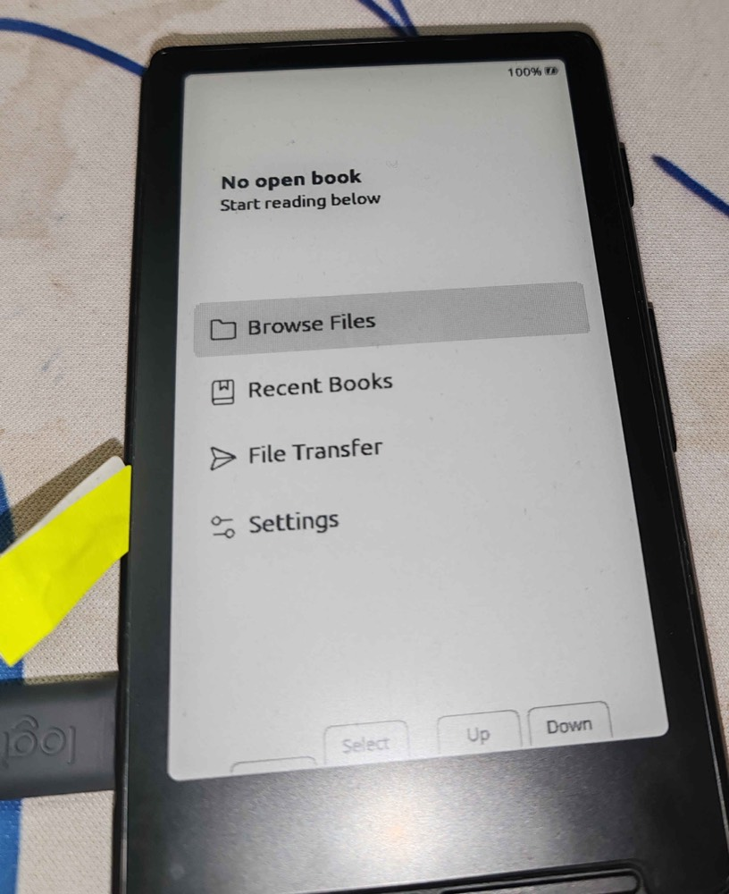

# Recovering a Bricked Reader with an External Programmer



This is a last-resort guide, inherited from CrossPoint Reader and adapted. It covers a reader that is bricked, or
stuck on firmware with no path to flash a replacement. It works by writing a firmware image directly to the SPI
flash chip with an external programmer, bypassing the microcontroller entirely.

**Read this before you open anything:**

- **You need a dump of your own device, made before anything goes wrong.** This repository does not ship a
  firmware dump, and you must not use someone else's. A full dump holds the vendor firmware and the donor
  device's stored settings (which can include Wi-Fi credentials), and it is not anyone's to hand out. Make your
  own dump now, while the device still starts (step 1 below).
- The photographed example is an **ESP32-C3** Xteink (X4/X3). The X4 Pro and X4 Classic that Plaque OS targets are
  **ESP32-S3** devices; use `--chip esp32s3` with esptool on those, and check your own board's flash chip and
  pinout before you attach a clip. Nothing here has been tested on an X4 Pro by the Plaque OS authors.
- If your device is not USB-locked, flash it over USB instead (see "Flash" in the [README](../README.md)); it is
  safer and much less invasive. Plaque OS can also install a `.bin` from the SD card (Settings > System > SD Card
  Firmware Update), which needs no tools at all. What follows is a last resort.

*Example: a device stuck on a third-party firmware, unresponsive to a normal USB flash.*

## Required Tools

- Acetone or another nail polish remover.
- A SPI flash programmer. On this guide we use a CH341a; A Bus Pirate, Raspberry Pi/Pico or suitable Arduino, also works.
- Programmer software. flashrom (with libftdi) work on all OSs.
- esptool.py, to make your own dump (step 1).
  
## Before You Start

- Lithium batteries are dangerous, do not short or puncture. Be careful.
- The display is fragile, don't bend or flex it. do not force the ZIF connector.
- There is no undo here. A mis-wired clip or a short circuit can turn a bricked device into a dead one. Proceed at your own risk.


## Procedure

### 1. Obtain a Firmware Image: dump your own device first

Dump the whole flash of your own, working, unlocked device over USB, and keep the file somewhere safe. This is
the image you will write back if the device is ever bricked:

- Turn the device on, connect the USB cable and do:

```bash
~$ pio pkg exec -p tool-esptoolpy -- esptool.py --chip esp32c3 -p /dev/ttyACM0 -b 921600 read_flash 0x000000 0x1000000 my-device-backup.bin
 # or
~$ esptool.py --chip esp32c3 -p /dev/ttyACM0 -b 921600 read_flash 0x000000 0x1000000 my-device-backup.bin
```

(`--chip esp32c3` is for the X4/X3. For an X4 Pro or X4 Classic use `--chip esp32s3`. The flash is 16 MB, which is
`0x1000000`. On macOS the port looks like `/dev/cu.usbmodem1101`.)

Run it twice and compare the two files (`shasum -a 256`): they should be identical. The file contains your
device's own stored data, so do not publish or share it.

If you can no longer start the device and have no dump of your own, this procedure cannot restore your device.
Do not write a `firmware.bin` from the build folder to the chip's start: it is only the application image for the
app slot, not a whole-flash image.

### 2. Disconnect Power Sources and Accessories

- Remove and set the SD card aside for reinsertion later.
- Remove any USB cable.
- Confirm nothing else is supplying power to the board.

### 3. Remove the Screen

Ordinary nail polish remover softens the adhesive under the screen's edges — it takes some patience, and there's no clean way around that.

- In a well ventilated space, free of any ignition source, apply acetone or nail polish remover to the borders of the screen.
- Check it from time to time, make sure the borders of the screen stay wet for around 2 hours.
- Start to pry open from a lower corner, and move around.
- If necessary, use a non-conductive tool to help you.
- Flip open the ZIF connector to release the screen from the board.




### 4. Disconnect the Battery

Cut a single battery wire close to the board, then cover the cut end with tape to prevent shorting.



### 5. Hold the Reset Button Down

Keeping reset held prevents the ESP32-C3 from interfering with SPI communication during the read/write. A piece of pointed plastic works well as a holder.



### 6. Attach the Test Clip

Connect the test clip to the flash chip before connecting the programmer to USB. Notes:

- The clip's red wire aligns with pin 1, marked with a dot on both the chip and the board silkscreen.
- Confirm each lead is making contact with a chip pin and not the epoxy body.
- If the programmer has a voltage selector, set it to 3.3V.
- Verify no other power source is connected — use a multimeter if there's any doubt.
  



### 7. Connect the Programmer to the PC



### 8. Verify the Connection by Reading Twice

Read the chip twice and compare hashes. If they don't match, something in the clip connection is off — fix that before writing anything to the chip.

```bash
~$ sudo flashrom --programmer ch341a_spi -r backup_0.bin
    [...]
    Reading flash... done.
~$ sudo flashrom --programmer ch341a_spi -r backup_1.bin
    [...]
    Reading flash... done.
    # lets compare the hashes from the back ups
~$ md5sum backup_0.bin
    <same hash twice>  backup_0.bin
~$ md5sum backup_1.bin
    <same hash twice>  backup_1.bin
```

### 9. Flash the Chip

```bash
~$ sudo flashrom --programmer ch341a_spi -w my-device-backup.bin
    [...]
    Reading old flash chip contents... done.
    Erasing and writing flash chip... Erase/write done.
    Verifying flash... VERIFIED.
```

### 10. Power and Test The Device

- Disconnect the programmer from the USB port.
- Remove the test clip.
- Release the reset button.
- Reinsert the SD card.
- Reconnect the screen.
- Power the device via USB cable, no need to solder the battery yet.
- Press the power button for a couple seconds.




If the device boots, it can be fully reassembled.

